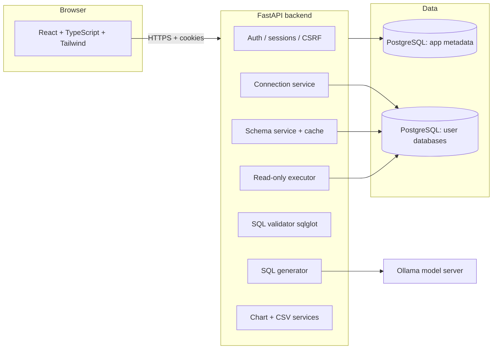

# QueryMind AI — Natural Language to SQL Intelligence

Ask questions in plain English against a **real PostgreSQL database** and get answers generated by a **real language model**, validated by independent application code, executed read-only, and returned as actual rows, charts and CSV.

This is not a mock: there is no hardcoded SQL, no canned answer and no fabricated result. If the model or the database is unavailable the API returns a real error and the UI shows it.

```
USER QUESTION
     |
     v
REAL LLM INFERENCE (Ollama, configurable model)
     |
     v
DYNAMIC SQL GENERATION (against the inspected schema)
     |
     v
INDEPENDENT SQL VALIDATION (parser-based allowlist, never trusts the model)
     |
     v
EXPLICIT EXECUTION APPROVAL (SQL preview + "Execute query" button)
     |
     v
READ-ONLY DATABASE EXECUTION (read-only session, statement timeout, row caps)
     |
     v
ACTUAL QUERY RESULTS (table, chart, plain-English explanation, metadata)
     |
     v
PERSISTED QUERY HISTORY (PostgreSQL, per-user ownership)
```

---

## 1. Features

**Authentication & accounts**
- Registration, login, logout, `GET /api/auth/me`, session restoration.
- Argon2 password hashing, server-side sessions stored as SHA-256 token hashes.
- HttpOnly session cookie + CSRF double-submit token on every mutation.
- Rate limiting on auth, generation, execution and connection tests.

**Database connections**
- Create, list, test, inspect, edit and delete PostgreSQL connections.
- Passwords encrypted at rest with Fernet (AES-128-CBC + HMAC); never returned to the browser.
- Destination policy blocking metadata endpoints and prohibited networks (SSRF defence).
- Connection pooling, connect timeout, per-connection cleanup.

**Schema discovery**
- Real inventory of schemas, tables/views, columns, data types, primary keys and foreign-key relationships.
- 5-minute cache with `?refresh=true` and cache invalidation on connection/upload changes.
- Searchable schema explorer in the UI; relationships shown as join hints.

**Natural language → SQL**
- Ollama provider (default `qwen2.5-coder:7b`), provider abstraction so the executor never depends on the model.
- Schema-constrained prompt with tables, columns, keys and relationships; conversation context for follow-ups.
- Structured JSON output parsing with malformed-response handling, timeouts and bounded retries.
- Ambiguous questions return a clarification request instead of guessing.
- Plain-English explanation of the generated SQL.

**SQL security**
- `sqlglot` (PostgreSQL dialect) parse tree validation — not regexes.
- Only `SELECT`; DDL/DML/`GRANT`/`COPY`/admin commands, multiple statements and unsupported functions are rejected.
- Every referenced schema/table/column must exist in the inspected schema.
- Re-validated at execution time; validation errors are returned with the generated SQL.
- Read-only database session (`default_transaction_read_only=on`), statement timeout, idle timeout, row and byte limits.

**Results**
- Sortable/paginated table, in-result search, column visibility, copy SQL, copy results.
- CSV export with spreadsheet formula-injection protection.
- Chart recommendation from the actual column shapes (bar / line / area / pie) with manual override.
- Execution time, row count, truncation flag and status.

**History, saved queries, conversations**
- Query history persisted with status, timing, row count and safe error summaries.
- Saved queries with title, description, tags, favourites, ownership checks and re-validation before execution.
- Conversations store per-turn SQL so follow-ups regenerate a fresh query.

**CSV upload**
- Preview columns and inferred types, then create a dataset table in a dedicated uploads schema.
- Size/encoding/name validation, parameterized inserts, cleanup on delete.

**UI/UX**
- React + TypeScript + Tailwind SaaS layout, responsive down to mobile.
- Light/dark themes with persisted preference, empty states, skeletons, toasts, dialogs and keyboard-accessible forms.

---

## 2. Architecture



| Layer | Files |
| --- | --- |
| API routes | [health.py](backend/app/api/health.py), [auth.py](backend/app/api/auth.py), [connections.py](backend/app/api/connections.py), [query.py](backend/app/api/query.py), [history.py](backend/app/api/history.py), [saved_queries.py](backend/app/api/saved_queries.py), [conversations.py](backend/app/api/conversations.py), [analytics.py](backend/app/api/analytics.py), [settings.py](backend/app/api/settings.py), [uploads.py](backend/app/api/uploads.py) |
| Services | [ai_service.py](backend/app/services/ai_service.py), [sql_generator.py](backend/app/services/sql_generator.py), [sql_validator.py](backend/app/services/sql_validator.py), [schema_service.py](backend/app/services/schema_service.py), [query_executor.py](backend/app/services/query_executor.py), [chart_service.py](backend/app/services/chart_service.py), [csv_service.py](backend/app/services/csv_service.py), [connection_service.py](backend/app/services/connection_service.py), [crypto.py](backend/app/services/crypto.py), [db_errors.py](backend/app/services/db_errors.py), [history_service.py](backend/app/services/history_service.py) |
| Security | [security.py](backend/app/core/security.py), [deps.py](backend/app/core/deps.py), [network_policy.py](backend/app/security/network_policy.py), [rate_limit.py](backend/app/core/rate_limit.py) |
| Deployment | [docker-compose.prod.yml](docker-compose.prod.yml), [backend/Dockerfile](backend/Dockerfile), [docker/web/Dockerfile](docker/web/Dockerfile), [docker/caddy/Caddyfile](docker/caddy/Caddyfile), [docs/deployment.md](docs/deployment.md) |
| Frontend | [App.tsx](frontend/src/App.tsx), [pages/](frontend/src/pages), [components/](frontend/src/components), [contexts/](frontend/src/contexts), [services/api.ts](frontend/src/services/api.ts), [types/api.ts](frontend/src/types/api.ts) |

---

## 3. Technology stack

**Backend** — Python 3.14, FastAPI, Uvicorn, Pydantic v2, SQLAlchemy 2, Psycopg 3, Alembic, Argon2 (`argon2-cffi`), `cryptography` (Fernet), `sqlglot`, pandas, pytest.
**Frontend** — React 18, TypeScript 5.7, Vite 6, Tailwind CSS 3, React Router 6, TanStack Query 5, React Hook Form + Zod, Recharts, Lucide icons, Vitest + React Testing Library.
**AI** — Ollama (local inference) behind a provider abstraction.
**Data** — PostgreSQL 16 (Docker) for both application metadata and the connected analytical database.

---

## 4. Prerequisites (Windows)

| Requirement | Verified version | Notes |
| --- | --- | --- |
| Python | 3.14 | `python --version` |
| Node.js | 24 | `node --version` |
| Docker Desktop | running | for the two PostgreSQL containers |
| Ollama | installed | https://ollama.com/download |

A local model needs roughly **5–6 GB of disk** and about **8 GB of RAM** for `qwen2.5-coder:7b`. Smaller models (`qwen2.5-coder:1.5b`) work on modest machines; larger ones need more memory.

---

## 5. Installation

```bash
# 1. Databases (app metadata on host port 5434, sample analytics DB on 5433)
docker compose up -d postgres postgres-analytics

# 2. Backend
cd backend
python -m venv .venv
./.venv/Scripts/python.exe -m pip install -r requirements.txt

# 3. Frontend
cd ../frontend
npm install
```

### 5.1 Environment configuration

```bash
cp .env.example .env          # then edit .env
```

Mandatory values:

| Variable | Purpose |
| --- | --- |
| `APP_ENV` | `development` or `production` (production enables Secure cookies) |
| `APP_SECRET_KEY` | session/CSRF signing secret — `python -c "import secrets; print(secrets.token_urlsafe(48))"` |
| `DATABASE_URL` | application metadata database |
| `AI_PROVIDER`, `OLLAMA_BASE_URL`, `OLLAMA_MODEL` | real model provider (`ollama`, default) and model name |
| `NVIDIA_API_KEY`, `NVIDIA_BASE_URL`, `NVIDIA_MODEL` | NVIDIA NIM provider — required when `AI_PROVIDER=nvidia`; the model ID comes from `NVIDIA_MODEL` and is never assumed |
| `ENCRYPTION_KEY` | **required** to save connections — `python -c "from cryptography.fernet import Fernet; print(Fernet.generate_key().decode())"` |
| `FRONTEND_ORIGIN` | CORS/cookie origin(s), e.g. `http://localhost:5173` (comma-separate several) |

Optional: `QUERY_TIMEOUT_SECONDS`, `MAX_QUERY_ROWS`, `MAX_RESULT_BYTES`, `ALLOW_PRIVATE_DB_HOSTS`, `DB_DESTINATION_ALLOWLIST`, `COOKIE_SECURE`, `COOKIE_SAMESITE`, `AUTH_RATE_LIMIT_PER_MINUTE`, `QUERY_RATE_LIMIT_PER_MINUTE`.

The application refuses to store connections when `ENCRYPTION_KEY` is missing, instead of falling back to plaintext. `.env` is git-ignored.

**Production configuration is validated at startup.** With `APP_ENV=production` the process refuses to start if `FRONTEND_ORIGIN` is not an explicit `https://` origin (a leading `*` wildcard or a `localhost` origin is rejected), or if cookies are explicitly marked non-Secure (`COOKIE_SECURE=false`). This prevents silently shipping credential cookies that the browser would drop or a wildcard CORS policy that would defeat them. See [config.py](backend/app/core/config.py).

### 5.2 Migrations

Pending migrations are applied **during startup, before the API serves its first request**: the FastAPI lifespan calls [backend/app/db/migrate.py](backend/app/db/migrate.py), which runs `alembic upgrade head`. In production a failed migration stops the process (fail-closed) instead of serving `relation ... does not exist` errors; concurrent starts queue on a PostgreSQL advisory lock; only `upgrade` is ever run — never `downgrade` or a drop. Alembic reads the same effective `DATABASE_URL` as the application (psycopg driver, `sslmode` and every other query parameter preserved).

To apply them explicitly instead (release step, deploy runbook):

```bash
cd backend
./.venv/Scripts/alembic upgrade head        # or: python -m app.db.migrate
```

Set `RUN_MIGRATIONS_ON_STARTUP=false` to disable the automatic step and keep migrations strictly release-driven.

### 5.3 AI model setup

```bash
ollama serve                          # usually already running on 11434
ollama list                           # see what is installed
ollama pull qwen2.5-coder:7b          # coding-capable model used here
```

Set `OLLAMA_MODEL` to whatever `ollama list` shows. Check availability through the app:

```bash
curl http://127.0.0.1:8001/api/health/ai
```

### 5.4 Alternative: NVIDIA NIM (hosted)

To run inference on NVIDIA's OpenAI-compatible endpoint instead of local Ollama:

```bash
AI_PROVIDER=nvidia
NVIDIA_API_KEY=...          # from https://build.nvidia.com (keep it secret)
NVIDIA_MODEL=...            # the exact model ID to use; nothing is assumed
# NVIDIA_BASE_URL defaults to https://integrate.api.nvidia.com/v1
```

Startup validation refuses to boot when `AI_PROVIDER=nvidia` and `NVIDIA_API_KEY`
or `NVIDIA_MODEL` is missing, so misconfiguration fails fast instead of erroring
on every query. The key is sent only as a `Bearer` token and is redacted from
errors, `/api/health/ai` status output and logs. The same check works:
`curl http://127.0.0.1:8001/api/health/ai`.

---

## 6. Running locally

```bash
# Terminal 1 — backend on port 8001 (port 8000 is often taken by other tools)
cd backend
./.venv/Scripts/python.exe -m uvicorn app.main:app --host 127.0.0.1 --port 8001

# Terminal 2 — frontend on port 5173 (Vite proxies /api -> 127.0.0.1:8001)
cd frontend
npm run dev
```

Open http://localhost:5173, create an account, add a PostgreSQL connection, and ask a question.

Sample analytics database (development only, seeded from [docker/analytics-init/01_sample_data.sql](docker/analytics-init/01_sample_data.sql)):

| Field | Value |
| --- | --- |
| Host / port | `localhost` / `5433` |
| Database | `analytics` |
| User / password | `analytics_owner` / `analytics_password_change_me` |
| SSL mode | `disable` |

It contains `regions`, `customers`, `products`, `orders`, `order_items` and a `monthly_sales` view.

### Useful commands

```bash
# stop the databases
docker compose down          # add -v to also delete the data volumes
```

---

## 7. Testing

Tests are grouped with pytest markers (registered in [pytest.ini](backend/pytest.ini)):

| Marker | Meaning |
| --- | --- |
| `live_llm` | needs the real AI provider and model — no mocks, ever |
| `reads_only` | needs a restricted SELECT-only database role |

The suite (145 tests) is: **142 fast tests** + **3 real-model tests**.

### Backend unit + integration tests (real PostgreSQL, no model needed)

```bash
cd backend
./.venv/Scripts/python.exe -m pytest -m "not live_llm" -q
```

These run against a separate `querymind_test` database and the sample analytics database. If a PostgreSQL service is missing they fail — they never fall back to SQLite.

### Real LLM integration tests

```bash
cd backend
./.venv/Scripts/python.exe -m pytest -m live_llm -q          # skips (with a reason) if no model
REQUIRE_LIVE_LLM=1 ./.venv/Scripts/python.exe -m pytest -m live_llm -q   # a missing model FAILS
```

`test_llm_integration.py` performs real inference against the configured Ollama model. **CI always sets `REQUIRE_LIVE_LLM=1`**, so an unreachable model can never be reported as a passing run. Verified locally:

| Scenario | Result |
| --- | --- |
| Model available, `REQUIRE_LIVE_LLM=1` | 3 passed (exit 0) |
| Model unreachable, `REQUIRE_LIVE_LLM=1` | 2 failed (exit 1) |
| Model unreachable, no enforcement (developer default) | 2 skipped (exit 0, explicit reason) |

### Read-only role enforcement (optional locally, required in CI)

CI creates a SELECT-only role and exports its credentials; without them these tests skip with a reason:

```bash
# one-off provisioning against the sample analytics database
docker exec querymind-analytics-db psql -U analytics_owner -d analytics -v ON_ERROR_STOP=1 \
  -c "CREATE ROLE analytics_ro LOGIN PASSWORD 'analytics_ro_change_me';" \
  -c "GRANT CONNECT ON DATABASE analytics TO analytics_ro;" \
  -c "GRANT USAGE ON SCHEMA public TO analytics_ro;" \
  -c "GRANT SELECT ON ALL TABLES IN SCHEMA public TO analytics_ro;"

cd backend
QM_READONLY_USER=analytics_ro QM_READONLY_PASSWORD=analytics_ro_change_me QM_READONLY_DB=analytics \
  ./.venv/Scripts/python.exe -m pytest app/tests/test_read_only_enforcement.py -q
```

These tests prove the database itself refuses writes (SELECT through the app works, `INSERT`/`UPDATE`/`DELETE`/`DROP`/`CREATE` are refused, and the app's read-only session raises `ReadOnlySqlTransaction`).

### Frontend tests, typecheck and production build

```bash
cd frontend
npm test          # vitest: 5 files, 26 tests
npm run typecheck
npm run build
```

### Live end-to-end verification against a running backend

```bash
cd backend
./.venv/Scripts/python.exe scripts/live_e2e_check.py --base-url http://127.0.0.1:8001
./.venv/Scripts/python.exe scripts/live_failure_check.py --base-url http://127.0.0.1:8001
```

These scripts drive the real HTTP API: register → connect → inspect schema → ask a question → validate → execute → **cross-check the rows against an independently executed SQL query** → history/saved queries/analytics → unsafe-SQL rejection → cross-tenant isolation. The failure script proves that an unreachable database and an unreachable model produce real errors (it starts a throwaway backend pointed at a closed port rather than touching your running Ollama).

Recorded evidence: [docs/verification-live-e2e.txt](docs/verification-live-e2e.txt) (46/46 checks) and [docs/verification-failure-paths.txt](docs/verification-failure-paths.txt) (9/9 checks).

The end-to-end script also connects a **second database with a different schema** (the application metadata database, overridable with `SECOND_SCHEMA_*` environment variables) and checks that generation adapts to it and that the returned count matches an independent `COUNT(*)`.

---

## 8. Continuous integration (GitHub Actions)

The pipeline lives in [.github/workflows/ci.yml](.github/workflows/ci.yml) with the change-detection helper [.github/scripts/detect-live-required.sh](.github/scripts/detect-live-required.sh).

| Job | What it proves | Runs |
| --- | --- | --- |
| `detect-changes` | decides whether the live checks are relevant to this change | always |
| `Backend tests (real PostgreSQL, migrations)` | migrations + `alembic check` + 142 tests against real PostgreSQL (two databases), read-only role included | always |
| `Frontend tests, typecheck and build` | `npm ci`, `tsc --noEmit`, 26 vitest tests, production build | always |
| `Security gates (SQL validation, auth, credentials, read-only role)` | parser allowlist, auth/ownership, credential handling, CSV upload, read-only role — and fails if those tests were skipped | always |
| `Failure-path verification (unreachable database and model)` | real error responses, no fabricated SQL/rows | live-relevant changes only |
| `Live verification (real Ollama model, real database)` | real inference, `pytest -m live_llm`, `scripts/live_e2e_check.py` | live-relevant changes only |
| `Verification summary` | one PASSED/FAILED/NOT RUN table, fails if any required job failed | always |

**Triggers** — pull requests and pushes to `main`/`master`, `workflow_dispatch` with a `live` input (`auto` | `always` | `never`), and a nightly `schedule` (`cron: "0 0 * * *"`, i.e. 00:00 UTC). Scheduled runs execute all seven jobs: the change gate emits `live=true` unconditionally for the `schedule` event, so the live model checks are never skipped by change detection.

The workflow uses only first-party actions (`actions/checkout`, `setup-python`, `setup-node`, `cache`, `upload-artifact`) with `permissions: contents: read`. If your security policy requires immutable references, replace each `@vN` with the reviewed commit SHA (and add Dependabot or Renovate to keep them current) — the change is mechanical and does not alter any command in this workflow.

**Change gating** — the live jobs run when the diff touches `backend/`, `alembic/`, `scripts/`, `requirements.txt`, `pytest.ini`, `docker-compose.yml`, `docker/`, `.env.example`, `frontend/src/{services,types}/` or `.github/`. Documentation-only changes skip them, so a 7B model is never downloaded for a README tweak. An unknown or uncomparable diff (first push, force push, unavailable base branch) is treated as *live required* on purpose. The helper is plain bash — it was tested against real git histories:

| Scenario | Decision |
| --- | --- |
| Docs-only push | `live=false` |
| `backend/app/services/…` push | `live=true` |
| Workflow/CI push | `live=true` |
| First push (all-zero `before`) | `live=true` |
| PR against an unavailable base branch | `live=true` (conservative) |
| `workflow_dispatch` with `live=always` / `never` | `true` / `false` |

The table above is the *documentation* form of the same logic the CI runs; the script behind it is [.github/scripts/detect-live-required.sh](.github/scripts/detect-live-required.sh), driven purely by environment variables (`EVENT`, `REQUESTED`, `BASE_REF`, `BEFORE`, `SHA`) and emitting a `live=<bool>` line to stdout and to `$GITHUB_OUTPUT`, which is what the workflow's `if:` conditions gate on.

### Exact commands (local equivalents of every CI step)

```bash
# 1. Fast backend tests (no model required)
cd backend && ./.venv/Scripts/python.exe -m pytest -m "not live_llm" -q

# 2. Frontend tests
cd frontend && npm test

# 3. TypeScript validation
cd frontend && npm run typecheck

# 4. Frontend production build
cd frontend && npm run build

# 5. PostgreSQL integration tests + migrations
docker compose up -d --wait postgres postgres-analytics
cd backend && ./.venv/Scripts/python.exe -m alembic upgrade head && ./.venv/Scripts/python.exe -m alembic check
cd backend && ./.venv/Scripts/python.exe -m pytest -m "not live_llm" -q --junitxml=../reports/pytest-backend.xml

# 6. Real LLM integration tests (requires Ollama + the configured model)
cd backend && REQUIRE_LIVE_LLM=1 ./.venv/Scripts/python.exe -m pytest -m live_llm -q -rs

# 7. Live end-to-end verification (requires the backend running, DBs and the model)
cd backend && ./.venv/Scripts/python.exe -m uvicorn app.main:app --host 127.0.0.1 --port 8001 &
cd backend && ./.venv/Scripts/python.exe scripts/live_e2e_check.py --base-url http://127.0.0.1:8001

# 8. Failure-path verification (needs the backend running; no model needed)
cd backend && ./.venv/Scripts/python.exe scripts/live_failure_check.py --base-url http://127.0.0.1:8001

# 9. Security tests (SQL validation, auth, credentials, CSV, read-only role)
cd backend && QM_READONLY_USER=analytics_ro QM_READONLY_PASSWORD=analytics_ro_change_me \
  ./.venv/Scripts/python.exe -m pytest -q app/tests/test_sql_validator.py app/tests/test_auth.py \
  app/tests/test_crypto_and_connections.py app/tests/test_csv_upload.py app/tests/test_read_only_enforcement.py
```

`reports/` is where CI writes its reports; the scripts keep their own console output and exit codes.

### Test configuration overrides

The tests and scripts read their service endpoints from the environment, so CI needs no code changes (defaults match `docker-compose.yml`):

| Variable group | Purpose |
| --- | --- |
| `QM_APP_DB_*`, `QM_TEST_DB_NAME` | application metadata database and the isolated test database |
| `QM_ANALYTICS_*` | sample analytics database used for real query execution |
| `QM_READONLY_*` | SELECT-only role; without it the read-only tests skip (CI treats that skip as a failure) |
| `SECOND_SCHEMA_*` | alternate-schema database used by the live E2E script |
| `REQUIRE_LIVE_LLM=1` | turns an unavailable model into a failure instead of a skip |

CI uses only disposable credentials for the ephemeral containers it starts; there are no production credentials, tokens or keys in the workflow. When the project later adds a hosted model provider, its key belongs in GitHub Actions secrets — never in the workflow file.

### CI failure semantics

| State | How it is reported |
| --- | --- |
| Passed | job green, summary row `PASSED` |
| Failed | job red, `::error` annotation naming the regression, summary row `FAILED` |
| Not executed (not required for this change) | job skipped, summary row `NOT RUN (not required for this change)` — never `PASSED` |
| Blocked by CI infrastructure | the job fails **and** the summary row reads `BLOCKED BY CI INFRASTRUCTURE (not a pass)`, with a footnote explaining that the live checks never ran |

The two live jobs expose a `blocked` output (the failure-path script's exit code `2`, and the outcome of the Ollama/backend startup steps), which is what lets the summary tell an infrastructure outage apart from an application regression.

### Reports and artifacts

Uploaded with 14-day retention: `reports/pytest-backend.xml/.txt`, `reports/pytest-security.*`, `reports/pytest-live-llm.*`, `reports/live-e2e.txt`, `reports/failure-paths.txt`, `reports/vitest.txt`, `reports/typecheck.txt`, `reports/build.txt`, plus backend/Ollama logs (stdout only).

These artifacts contain the sample-data values used by the checks (for example the product/revenue pairs read from the ephemeral analytics database) and never contain credentials, tokens, encryption keys or connection strings with passwords. The application never prints stored passwords, and the CI containers hold only disposable credentials.

### Reproducing a CI failure locally

1. Read the job summary and the artifact for the failing step.
2. Start the same services: `docker compose up -d --wait postgres postgres-analytics` and, for live jobs, `ollama serve` + `ollama pull qwen2.5-coder:7b`.
3. Re-run the matching command from the list above with the same environment (`REQUIRE_LIVE_LLM=1`, `QM_READONLY_*`) — CI runs the same scripts you run locally, so failures reproduce.
4. If the failing step needs a service CI provides, start it locally with `docker compose` instead of guessing.

### Runner requirements and cost control

- `ubuntu-latest` (4 vCPU, 16 GB) is enough, but 7B CPU inference is slow: the live job has a 90-minute timeout and the backend uses `AI_TIMEOUT_SECONDS=180`.
- Requires Docker with the Compose v2 plugin (`docker compose up --wait`, i.e. Compose 2.20+) — present on GitHub-hosted runners.
- The workflow pins the verified local baseline `python-version: "3.14"` and `node-version: "24"` (`backend-tests`, `security-suite`, both live jobs; Node only in `frontend-checks`). If a runner image does not yet publish 3.14, change that single value in the job — no other step depends on it; the suite itself is version-agnostic Python 3.10+.
- The Ollama model is cached with `actions/cache`, keyed by model name, so it is downloaded only on a cache miss.
- **Self-hosted runner option:** on a machine with the model already pulled, change `runs-on:` for the live job to `[self-hosted, linux, ollama]` — the rest of the job works unchanged and would be markedly faster.
- Live checks only run for live-relevant changes or an explicit `workflow_dispatch` with `live=always`.

### Branch protection (recommended)

Require these checks on your main branch:

1. `Backend tests (real PostgreSQL, migrations)`
2. `Frontend tests, typecheck and build`
3. `Security gates (SQL validation, auth, credentials, read-only role)`
4. `Verification summary`
5. `Live verification (real Ollama model, real database)`

Points that matter:

- Live jobs are **inside the same workflow** and gated with `if:` rather than workflow-level `path` filters on purpose. A job skipped by `if:` reports *success*, so required checks behave correctly when live verification is not needed; a workflow skipped by `paths:` never creates the check run and would leave the PR permanently “Expected”.
- A failed live job fails the run and the summary — it can never be masked by another job succeeding.
- To force the live checks on a PR, run **Actions → CI → Run workflow** with `live=always`, or add the `run-live` label to your policy if you later switch to a labeling gate.
- Keep “Require branches to be up to date” optional; the live job is the expensive one.

### Enabling it on GitHub

This checkout is connected to `https://github.com/9618493162/QUERYMIND-AI` (verify with `git remote -v`); pushing `main` triggers the workflow:

```bash
git push -u origin main
```

Then, in the repository: **Settings → Actions → General** (allow Actions), and **Settings → Branches → Add branch protection rule** for `main` with the checks listed above. Trigger the workflow once with `live=always` to validate the live path end to end (the first run downloads the 7B model into the cache).

### Verification status of this pipeline

- **Validated locally:** workflow YAML parses; `actionlint` (v1.7.7) reports **no findings** including shellcheck on every `run:` block; the change-detection helper was exercised against real git histories; `docker compose up -d --wait` returns 0 with both databases healthy; `npm ci --dry-run` shows the lockfile is in sync; `alembic upgrade head` + `alembic check` report no drift; the security skip-gate passes when the read-only role exists and **fails** when it does not; `ollama list` parsing finds `qwen2.5-coder:7b`; `REQUIRE_LIVE_LLM` was proven to fail (not skip) with the model unreachable; and the summary script extracted from the workflow was executed against three synthetic job graphs — green with live checks not required (exit 0, `NOT RUN`), a fast-test regression (exit 1, `FAILED`), and an infrastructure outage (exit 1, `BLOCKED BY CI INFRASTRUCTURE (not a pass)`).
- **Validated on a real GitHub Actions run:** run #2 on `d53a9a5` (https://github.com/9618493162/QUERYMIND-AI/actions/runs/38115130251) completed with **all 7 jobs green**, including the pieces that only exist on Linux runners: Ollama install, model cache, 7B model pull, real inference, `pytest -m live_llm` with `REQUIRE_LIVE_LLM=1`, the live E2E script, and the failure-path script. Run #1 failed in `Detect changed areas` because the gate script's interface had drifted from what `ci.yml` invokes; the contract was restored and the decision matrix re-verified locally before run #2.
- **Still to validate:** branch protection with the five required checks (repository settings). The nightly `schedule` trigger (`0 0 * * *` UTC) is configured and its gate path is covered by the local decision matrix, but the cron has not fired yet — the first actual scheduled run is the remaining remote validation.

## 9. API

| Method | Path | Description |
| --- | --- | --- |
| GET | `/api/health` | **liveness** — process is up (never touches the database) |
| GET | `/api/health/ready` | **readiness** — 503 while the metadata database is unreachable |
| GET | `/api/health/ai` | real provider + model availability (cached ~15 s) |
| POST | `/api/auth/register` · `/api/auth/login` · `/api/auth/logout` | session lifecycle (CSRF protected) |
| GET | `/api/auth/me` | current user |
| GET/POST | `/api/connections` | list / create connections |
| POST | `/api/connections/test` | test credentials against the real server |
| GET/DELETE | `/api/connections/{id}` | fetch / delete a connection |
| GET | `/api/connections/{id}/schema` | live schema metadata (`?refresh=true`) |
| POST | `/api/query/generate` | natural language → SQL (+ explanation, validation) |
| POST | `/api/query/validate` | validate SQL against the live schema |
| POST | `/api/query/execute` | execute approved read-only SQL |
| GET/DELETE | `/api/history`, `/api/history/{id}` | query history |
| GET/POST/PATCH/DELETE | `/api/saved-queries`, `/api/saved-queries/{id}` | saved queries |
| GET/POST | `/api/conversations`, `/api/conversations/{id}/messages` | conversation memory |
| GET | `/api/analytics/overview` | dashboard statistics computed from real rows |
| POST | `/api/analytics/chart-recommendation` | chart suggestion for a result shape |
| GET/PATCH | `/api/settings` | user preferences |
| POST/GET/DELETE | `/api/uploads`, `/api/uploads/preview` | CSV datasets |

Errors use a consistent envelope:

```json
{ "success": false, "error": { "code": "db_unreachable", "message": "...", "details": [] } }
```

---

## 10. Security architecture

- **Credentials** — Fernet-encrypted at rest; only `has_password` is exposed; the password is never sent back to the browser or written to history.
- **Sessions** — opaque random tokens, HttpOnly/SameSite=Lax cookies, SHA-256 hashed server-side, expiry 7 days, `Secure` in production.
- **CSRF** — double-submit token (`querymind_csrf` cookie + `x-csrf-token` header) enforced on all mutating routes. The browser client bootstraps the cookie at most once and never sends a mutation without a token; a `401` clears the latch so an expired session can recover.
- **Startup configuration gate** — production startup fails on an insecure CORS/cookie configuration instead of running with it.
- **Authorization** — every connection, history entry, saved query, conversation, dataset and settings row is scoped by `user_id`; another user's resource returns 404.
- **SQL safety** — parse-tree allowlist (`sqlglot`), single statement only, schema/table/column existence checks, re-validation before execution, read-only session and SELECT-only role guidance.
- **Resource limits** — statement timeout (15 s default), row cap (1000), response byte cap (5 MB), per-user rate limits, request-size limits.
- **SSRF** — user-supplied hosts pass a destination policy that blocks cloud metadata addresses and, in production, private ranges unless explicitly allowlisted.
- **Logging** — no credentials or tokens are logged; database errors surface as safe summaries.

---

## 11. Verified behaviour

Executed on 2026-10-10 on Windows with Docker Desktop (PostgreSQL 16.14), Ollama `qwen2.5-coder:7b` and the sample analytics database.

Re-verified on 2026-10-11 after the CSRF/cookie hardening and production-containerisation changes:

| Check | Result |
| --- | --- |
| Backend fast suite (`pytest -m "not live_llm"`) | **139 passed, 3 skipped, 3 deselected** (exit 0) |
| Backend real-model suite (`REQUIRE_LIVE_LLM=1 pytest -m live_llm`) | **3 passed** (99 s, real Ollama inference) |
| Frontend | **26 passed** (5 files), `tsc --noEmit` clean, production build ok |
| Container stack (production mode, same origin over HTTPS) | liveness 200, readiness 200 with `database.connected=true`, SPA root and deep link 200, HSTS + nosniff + DENY headers, `401` without a session, `403 csrf_failed` without a token, `308` HTTP→HTTPS redirect, `Secure`+`HttpOnly` session cookie, `immutable` asset caching, 6 MB upload rejected at the edge with no backend request |

The 3 skips are the SELECT-only-role tests, which skip with an explicit reason when `QM_READONLY_*` is unset and are never counted as passes.

| Check | Result |
| --- | --- |
| Backend test suite | 145 tests: 142 fast + 3 real-model |
| Frontend tests / typecheck / build | 26 passed, typecheck clean, production build succeeds |
| Live end-to-end (real model, real DB, two different schemas) | 46/46 checks passed |
| Failure paths (unreachable DB / unreachable model) | 8/8 checks passed (a harness outage exits 2 as BLOCKED instead of passing) |

Observed end-to-end question: *"What are the top 5 products by total revenue? Sort highest first."*
SQL returned by the model:

```sql
SELECT p.product_name, SUM(oi.quantity * oi.unit_price) AS total_revenue
FROM order_items oi
JOIN products p ON oi.product_id = p.product_id
GROUP BY p.product_name
ORDER BY total_revenue DESC
LIMIT 5;
```

API result (identical to an independently executed query):

| product_name | total_revenue |
| --- | --- |
| Aurora Laptop 14 | 6495.00 |
| Nimbus Headphones | 1596.00 |
| Ergo Keyboard | 745.00 |
| Trail Runner Shoes | 539.40 |
| Desk Lamp Pro | 450.00 |

Unsafe statements (`DROP TABLE customers`, `SELECT 1; DELETE FROM orders;`, `UPDATE products SET unit_price = 0`) were rejected by validation and returned HTTP 400 on execute.

Schema adaptation, verified against a second, completely different database (the application metadata database): asking *"How many user accounts are registered?"* produced

```sql
SELECT COUNT(*) AS registered_user_count FROM public.users;
```

which returned the same count as an independently executed `SELECT COUNT(*) FROM users` (27 at the time of the run), with the column reported as type `number`. The same question against the analytics database would have had to use a different table — nothing about the schema is hardcoded.

CSV export was verified by capturing the actual downloaded bytes in the browser (`category,revenue` followed by the real rows), and formula-injection protection is unit-tested for values starting with `=`, `+`, `-`, `@`, tab or CR.

Two real defects were found by this verification and fixed:

1. **Write-then-read race** — FastAPI finalizes `get_db` *after* the response is sent, so `POST /api/connections` followed immediately by `GET .../schema` (or `/api/auth/me` right after login) could miss its own write. Handlers now commit before responding. See [session.py](backend/app/db/session.py).
2. **Every result column typed as `string`** — Psycopg reports type OIDs, so column kinds are now resolved through the psycopg type registry with a value-based fallback, which also fixed chart recommendations (numeric results now offer bar/line/pie instead of a plain table). See [query_executor.py](backend/app/services/query_executor.py).

---

## 12. Deployment

The container stack lives in [docker-compose.prod.yml](docker-compose.prod.yml) and is documented step by step in **[docs/deployment.md](docs/deployment.md)** (runbook, resource sizing, migrations, backups, verification).

```
Browser ──HTTPS──> Caddy ──/api/*──> FastAPI ──> PostgreSQL
                          └──/* ────> React SPA     └─> Ollama
```

- **One origin** — Caddy serves the built SPA and proxies `/api/*` to the backend, so the session cookie and CSRF double-submit token work unchanged. Do not split the SPA onto a different host without also changing the client's credentials mode.
- **Images** — [backend/Dockerfile](backend/Dockerfile) (FastAPI + uvicorn, non-root, liveness healthcheck) and [docker/web/Dockerfile](docker/web/Dockerfile) (Vite build → Caddy runtime). Built from the repository root so [.dockerignore](.dockerignore) keeps secrets, virtualenvs and Git history out of every layer.
- **Only Caddy is public** — PostgreSQL, Ollama and FastAPI stay on the internal network; no credential is hardcoded, required values are interpolated and fail fast when unset.
- **Migrations** — applied automatically during startup, before the API serves traffic (fail-closed in production; `RUN_MIGRATIONS_ON_STARTUP=false` opts out). The explicit release step remains available: `--profile tools run --rm migrate`.
- **Probes** — `/api/health` (liveness) and `/api/health/ready` (readiness, 503 on a database outage); `/api/health/ai` is diagnostics only and is cached so probes do not hammer the model.
- **Proxy trust** — only `TRUSTED_PROXY_IPS` may set `X-Forwarded-For`; the rate limiter ignores the header from anyone else.
- **Production checklist** — `APP_ENV=production`, `FRONTEND_ORIGIN=https://<domain>`, `ALLOW_PRIVATE_DB_HOSTS=false` (with `DB_DESTINATION_ALLOWLIST` if you want to pin hosts), real secrets from the environment/secret manager, and PostgreSQL never exposed publicly.

The stack has been built and validated locally (see [docs/deployment.md](docs/deployment.md)); it has **not** been deployed to a host.

---

## 13. Known limitations

- PostgreSQL is the only supported analytical database type (`database_type` is validated server-side).
- The read-only guarantee is enforced in application code plus a read-only session; for a hard guarantee, connect with a role that only holds `SELECT` grants (documented above).
- Schema caches live in process memory (5-minute TTL). Multi-worker deployments refresh per worker; use `?refresh=true` to force.
- CSV uploads create tables in a dedicated uploads schema and are not scanned for PII.
- Conversation context is limited to the recent turns and is treated as untrusted input.
- Rate limiting is in-process per user/IP, so a multi-instance deployment needs a shared store (e.g. Redis); see [docs/rate-limiting.md](docs/rate-limiting.md) for the current behaviour, its limitations and the recommended migration path.
- Chart support covers bar, line, area and pie; other visualisations would need new components.

---

## 14. Troubleshooting

| Symptom | Cause / fix |
| --- | --- |
| `503 provider_unavailable` on generate | Ollama is not running or `OLLAMA_MODEL` is not installed — `ollama serve`, `ollama list`, `ollama pull <model>`. |
| `db_unreachable` when executing | Wrong host/port, container stopped (`docker compose ps`), or the destination policy blocked the host. |
| Connections cannot be saved | `ENCRYPTION_KEY` is missing or not a valid 32-byte Fernet key. |
| 401 immediately after login on an old build | Fixed by the commit-before-response change; pull the current backend. |
| `password authentication failed` | Check the connection's username/password or the server's `pg_hba.conf`. |
| Port already in use | The backend defaults documented here use `8001`; the Vite proxy targets `http://127.0.0.1:8001`. |

---

## 15. Project structure

```
querymind-ai/
|-- backend/
|   |-- app/
|   |   |-- api/            # FastAPI routers
|   |   |-- core/           # config, security, deps, errors, rate limiting
|   |   |-- db/             # engine + session
|   |   |-- models/         # SQLAlchemy models
|   |   |-- schemas/        # Pydantic request/response models
|   |   |-- security/       # destination/network policy
|   |   |-- services/       # AI, SQL generation/validation, schema, execution, charts, CSV
|   |   |-- tests/          # pytest suite
|   |   `-- main.py
|   |-- alembic/            # migrations
|   |-- scripts/            # live_e2e_check.py, live_failure_check.py
|   `-- requirements.txt
|-- frontend/
|   |-- src/                # pages, components, contexts, services, types, utils, tests
|   |-- package.json
|   |-- vite.config.ts
|   `-- tsconfig.json
|-- docker/analytics-init/  # sample analytics data (development only)
|-- docs/                   # rate-limiting notes and recorded verification evidence
|-- .github/
|   |-- workflows/ci.yml    # CI pipeline
|   `-- scripts/            # change-detection helper used by CI
|-- reports/                # generated test reports (git-ignored)
|-- docker-compose.yml
|-- .env.example
|-- .gitattributes          # keeps scripts LF for the Linux CI runners
`-- README.md
```

---

## 16. Next steps

- A SQL editor component with schema-aware autocomplete.
- Shared rate-limit/session store for multi-instance deployments.
- Scheduled/refreshed "saved answers" with alerts on change.
- Support for additional dialects (MySQL, SQLite) behind the existing executor interface.
- Optional hosted LLM provider configuration for teams without local GPU capacity.
